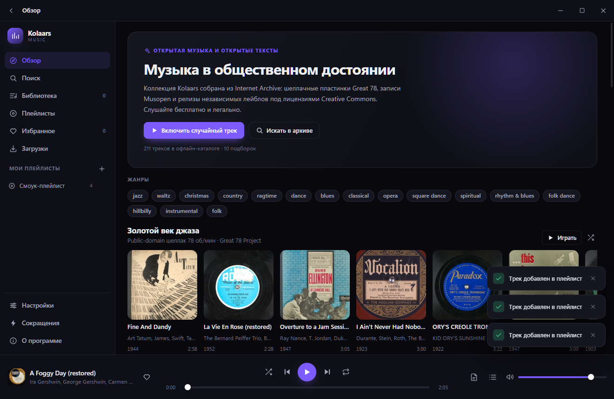
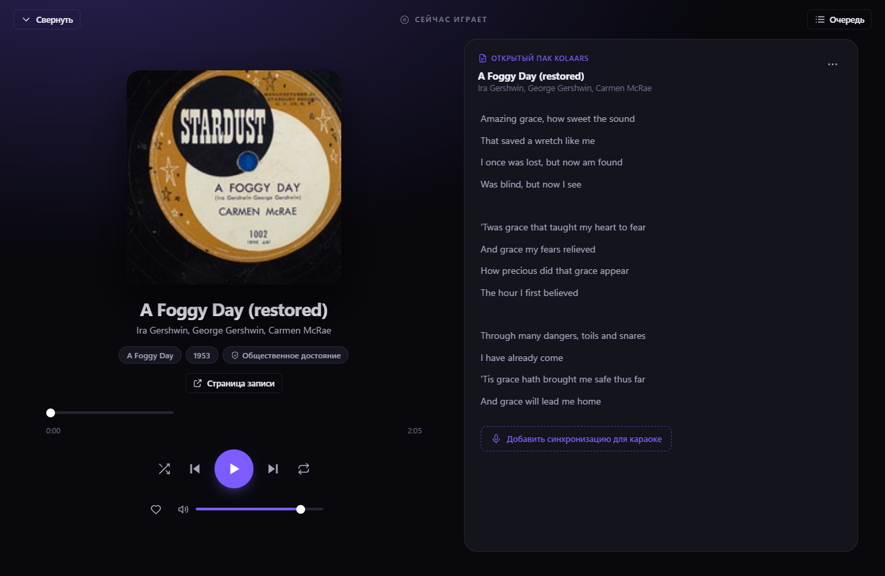
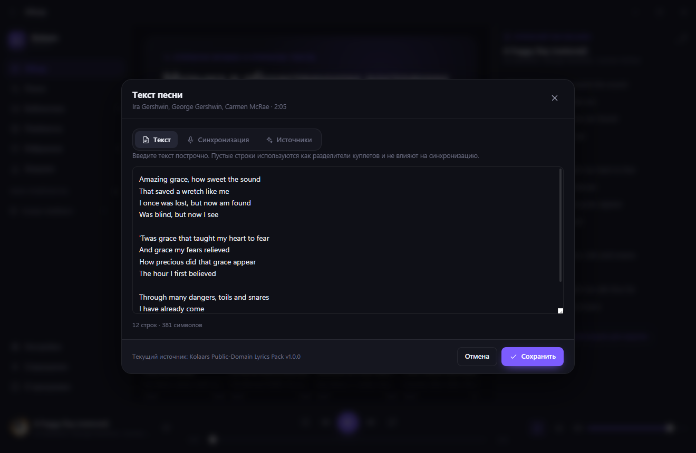
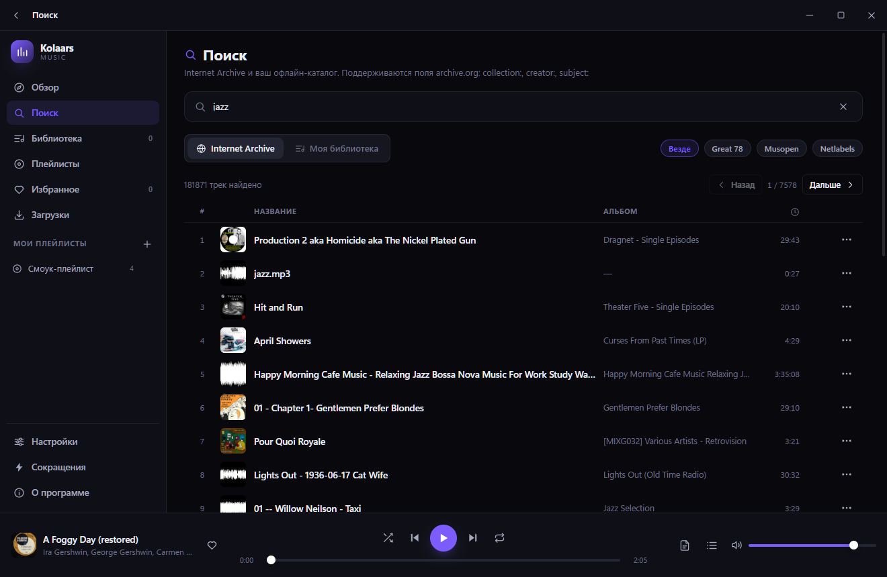

# Kolaars Music

**Открытый музыкальный проигрыватель для Windows: только свободная музыка и открытые тексты.**

[](LICENSE)
[](#требования)
[](https://www.electronjs.org/)
[](https://react.dev/)

Kolaars Music — настольное приложение-музыкальный сервис без регистрации, аккаунтов и
телеметрии. Вся музыка — общественное достояние или Creative Commons из Internet Archive,
все тексты — открытые (встроенный сборник общественного достояния + LRCLIB + Wikisource).

> Интерфейс приложения полностью на русском языке. Каждый трек сопровождается ссылкой на
> первоисточник и сведениями о лицензии.

---

## Содержание

- [Скриншоты](#скриншоты)
- [Возможности](#возможности)
- [Требования](#требования)
- [Разработка](#разработка)
- [Скрипты](#скрипты)
- [Сборка дистрибутивов](#сборка-дистрибутивов)
- [Тестирование](#тестирование)
- [Хранение данных](#хранение-данных)
- [Архитектура](#архитектура)
- [Данные и лицензии](#данные-и-лицензии)
- [Участие в проекте](#участие-в-проекте)
- [English](#english)

---

## Скриншоты

| Обзор | Сейчас играет |
| --- | --- |
|  |  |

| Мастерская текстов | Поиск в архиве |
| --- | --- |
|  |  |

Полный набор экранов — в `docs/screenshots/`. Их создаёт сам тест:
`node scripts/smoke.mjs --screenshot=docs/screenshots`.

## Возможности

### Музыка

- **Обзор** — 10 подборок из открытых коллекций: джаз, блюз, раннее кантри, рэгтайм,
  танцевальные оркестры, вальсы, рождественская классика, классика и опера, Musopen и
  независимые лейблы (CC). Подборки появляются мгновенно из встроенного каталога, а затем
  дополняются свежими результатами из Internet Archive.
- **Поиск** по Internet Archive с разбивкой по страницам, ограничением по коллекциям и
  сортировкой по популярности (в выборку попадает только `mediatype:audio`).
- **Библиотека** — импорт файлов и папок с диска (MP3, FLAC, OGG, M4A, WAV и другие),
  чтение тегов и обложек через `music-metadata`.
- **Файлы без тегов** — выгрузка из музыкальных сервисов обычно приходит без единого тега,
  с названием только в имени файла и обложкой отдельной картинкой рядом. Такие папки
  разбираются как есть: исполнитель и название берутся из имени `Исполнитель - Название`,
  обложка — из соседнего файла (`Трек.flac.cover.jpg`, `Трек.jpg`, `cover.jpg`), а
  длительность подставляется при первом воспроизведении.
- **Импорт списка треков** — вставьте список «Исполнитель — Название» или откройте
  `.txt`/`.csv`/`.m3u` из другого сервиса. Каждая строка сопоставляется с вашей библиотекой,
  затем (по желанию) с открытым архивом и LRCLIB, и сохраняется плейлистом.
- **Экспорт плейлиста** в M3U8, CSV или JSON — чтобы перенести список в другой сервис или
  открыть в таблице.
- **Избранное, плейлисты и очередь воспроизведения** с перемешиванием и режимами повтора.
- **Загрузки** — сохранение треков на диск для прослушивания офлайн.

### Профили

- **Несколько независимых библиотек на одном компьютере.** У каждого профиля свои треки,
  плейлисты, избранное, тексты, обложки и офлайн-загрузки — целиком в отдельной папке.
- Переключение, создание, переименование и удаление на экране «Настройки»; единственный
  профиль удалить нельзя.
- Это **не аккаунты**: вход, пароль и сеть не нужны, данные не покидают компьютер.

### Тексты песен

- **Встроенный сборник** из 65 песен общественного достояния, работает без интернета.
- **Синхронизированный LRC** с подсветкой текущей строки.
- **Онлайн-поиск** только по вашему действию: LRCLIB (тексты и тайминги от сообщества) и
  Wikisource (проверенные тексты в общественном достоянии).
- **Мастерская текстов** — поиск, сравнение кандидатов, ручная правка, синхронизация по
  клику, импорт и экспорт `.lrc`.

### Интерфейс

- Тёмная и светлая темы, настраиваемый акцентный цвет, четыре варианта вида списков.
- Собственная рамка окна, полноэкранный режим «Сейчас играет», панели текста и очереди.
- Полный справочник клавиатурных сокращений в приложении, поддержка медиа-клавиш Windows.

### Приватность и безопасность

- **Нет аккаунтов, нет собственных серверов, нет аналитики.** Сеть используется только для
  запросов к открытым API Internet Archive, LRCLIB и Wikisource.
- **Профили полностью локальны.** Несколько независимых библиотек на одном компьютере; ни
  регистрации, ни пароля, ни обмена данными между устройствами.
- Изолированный рендерер: `contextIsolation`, `sandbox`, без `nodeIntegration`.
- Локальный звук и обложки отдаются через привилегированную схему `kmedia://` со строгим
  списком разрешённых путей — прямого доступа к `file://` у интерфейса нет.
- Строгий CSP применяется и к собранному приложению.

---

## Требования

| Компонент | Версия |
| --- | --- |
| Windows | 10 или 11, x64 |
| Node.js | ≥ 20.19.0 (проверено на 24.x) |
| npm | 10 или новее |

Интернет нужен только для онлайн-поиска музыки и текстов; встроенный каталог и сборник
текстов работают офлайн.

---

## Разработка

```powershell
git clone https://github.com/Kolaars/kolaars-music.git
cd kolaars-music
npm install
npm run dev
```

Если в PowerShell запрещены скрипты `.ps1`, вызывайте npm напрямую:

```powershell
& "C:\Program Files\nodejs\npm.cmd" run dev
```

`npm run dev` поднимает Vite с горячей заменой модулей и запускает Electron. Главный процесс
собирается в `out/main`, прелоад — в `out/preload`, интерфейс — в `out/renderer`.

Перед коммитом стоит прогнать полный набор проверок:

```powershell
npm run typecheck   # tsc для main/preload и для renderer
npm run build       # production-сборка всех трёх процессов
npm run smoke       # сборка + автоматический тест интерфейса
```

---

## Скрипты

| Команда | Что делает |
| --- | --- |
| `npm run dev` | Запуск приложения в режиме разработки (HMR). |
| `npm run start` | Просмотр production-сборки через `electron-vite preview`. |
| `npm run build` | Сборка main, preload и renderer в каталог `out/`. |
| `npm run typecheck` | Проверка типов (`typecheck:node` + `typecheck:web`). |
| `npm test` | Все юнит-проверки без Electron (`test:tracklist` + `test:covers`). |
| `npm run test:tracklist` | Юнит-проверки разбора списков треков и экспорта плейлистов. |
| `npm run test:covers` | Юнит-проверки поиска обложек рядом с аудиофайлом. |
| `npm run smoke` | Сборка + автоматический smoke-тест интерфейса. |
| `npm run smoke:packaged` | Smoke-тест **упакованного** приложения из `release/win-unpacked`. |
| `npm run tools:seed` | Готовит офлайн-кэш инструментов упаковки (запускается автоматически перед `pack`/`dist`). |
| `npm run pack` | Сборка и упаковка распакованного приложения в `release/win-unpacked`. |
| `npm run dist` | Дистрибутив по умолчанию (NSIS + portable). |
| `npm run dist:win` | Дистрибутив для Windows. |
| `npm run dist:portable` | Только портативный `.exe`. |
| `npm run dist:nsis` | Только установщик NSIS. |

Вспомогательные скрипты в `scripts/` запускаются напрямую через `node`:

| Скрипт | Назначение |
| --- | --- |
| `node scripts/generate-icons.mjs` | Перерисовывает иконки приложения в `resources/`. |
| `node scripts/build-seed-catalog.mjs [--per-shelf 24]` | Пересобирает `data/seed-catalog.json` из живых запросов Internet Archive. |
| `node scripts/fetch-builder-tools.mjs [--all] [--list]` | Готовит офлайн-кэш `electron-builder`. |
| `node scripts/smoke.mjs [--screenshot=DIR] [--keep-open]` | Smoke-тест по CDP; сохраняет экраны интерфейса. |
| `node scripts/smoke-packaged.mjs [--exe=PATH] [--screenshot=DIR]` | Smoke-тест собранного приложения (asar, `kmedia://`, локальный импорт). |

---

## Сборка дистрибутивов

```powershell
npm run dist:portable   # release/kolaars-music-1.1.1-portable.exe
npm run dist:nsis       # release/kolaars-music-1.1.1-setup.exe
```

Конфигурация упаковки — `electron-builder.yml`: установщик NSIS и портативная версия для
Windows x64, иконки из `resources/`, `data/seed-catalog.json` попадает в `resources/data/`.
`music-metadata` исключён из архива asar (`asarUnpack`), потому что главный процесс
загружает его динамическим `import()`.

### Сборка без доступа к GitHub release-assets

`electron-builder` по умолчанию скачивает дополнительные инструменты (rcedit, 7-Zip, NSIS) и
альтернативный открытый `ffmpeg` с GitHub. В сетях, где клиент Node не может дойти до
`release-assets.githubusercontent.com`, а `curl.exe` работает, упаковка падает с
`RequestError`. Поэтому проект уже настроен на офлайн-путь:

* `electronDist: node_modules/electron/dist` — упаковка использует Electron, распакованный
  при `npm install`, вместо повторной загрузки zip-архива из релиза;
* `downloadAlternateFFmpeg: false` — берётся `ffmpeg.dll` из дистрибутива Electron.

Остаются инструменты правки ресурсов и сборки установщика. Их кэш проверяется и при
необходимости скачивается по `curl.exe` с проверкой SHA-256 **автоматически** перед каждой
командой упаковки (`tools:seed`); заранее прогреть кэш можно и вручную:

```powershell
npm run tools:seed   # rcedit, 7-Zip и NSIS → кэш electron-builder
npm run pack         # после этого упаковка идёт без обращений к сети
```

Каталог кэша — `%LOCALAPPDATA%\electron-builder\Cache`; путь можно переопределить переменной
окружения `ELECTRON_BUILDER_CACHE`. Если сеть до GitHub всё-таки доступна и вы хотите
отгружать сборку без проприетарных кодеков, верните `downloadAlternateFFmpeg: true`.

---

## Тестирование

`npm run test:tracklist` проверяет чистую логику импорта — разбор строк, CSV с заголовком,
M3U, нормализацию для сопоставления и круговорот «экспорт → импорт». Тесты запускают
настоящий модуль `src/shared/tracklist.ts` (он компилируется во временный каталог), а не его
копию, и не требуют Electron.

`npm run test:covers` так же проверяет поиск обложки рядом с аудиофайлом
(`src/main/sidecarCover.ts`) на настоящих файлах во временном каталоге: оба соглашения
именования, порядок приоритета, регистр букв, каталоги и пустые файлы вместо картинок.
Обе группы запускаются одной командой `npm test`.

`npm run smoke` собирает приложение, запускает настоящий Electron с включённой отладкой по
протоколу Chrome DevTools и проверяет, что интерфейс действительно поднялся: оболочка, меню,
подборки, воспроизведение по клику на карточку, транспорт, панель текста, панель очереди,
экран «Сейчас играет», переходы по маршрутам, создание плейлиста, поиск по встроенному
сборнику текстов, живой поиск в Internet Archive и импорт папки без тегов с обложками
отдельными файлами. Любое необработанное исключение или вызов `console.error` в рендерере
валит тест.

```powershell
node scripts/smoke.mjs --screenshot=docs/screenshots   # сохранить экраны интерфейса
node scripts/smoke.mjs --keep-open                       # не закрывать окно после теста
```

Отдельно проверяется то, что не может проверить запуск из исходников, — сам
**упакованный** артефакт. `npm run smoke:packaged` открывает `release/win-unpacked`, убеждается,
что интерфейс загрузился из `app.asar`, что `music-metadata` разрешается из распакованного
архива (теги и длительность локального файла), что боковой `.lrc` импортировался и что
привилегированная схема `kmedia://` действительно проигрывает локальный файл:

```powershell
npm run pack                    # собрать release/win-unpacked
npm run smoke:packaged          # или: node scripts/smoke-packaged.mjs --exe=PATH
```

---

## Хранение данных

Всё состояние приложения — один документ `kolaars.json` внутри каталога **профиля** в
`%APPDATA%\Kolaars Music\profiles\<id>\`. Он пишется **атомарно** (через временный файл и
переименование) и с задержкой (debounce), поэтому его удобно просматривать, копировать и
бэкапить. Рядом лежат подкаталоги `downloads/` (офлайн-загрузки) и `covers/` (обложки) —
то есть профиль целиком переносится копированием одной папки.
Обложка, лежащая рядом с треком, не копируется в профиль: на неё просто ссылаются.

Список профилей и активный профиль хранит небольшой реестр `profiles.json` в корне
каталога данных. Если каталог остался от версии без профилей (файл `kolaars.json` лежал в
корне), при первом запуске он переносится в профиль «Основной» — существующая библиотека не
теряется.

В документе хранятся настройки, плейлисты, избранное, тексты, история и состояние сессии.
Списки треков ссылаются на записи **по идентификатору**, а сами треки лежат в отдельном
словаре и во встроенном каталоге — поэтому файл не раздувается даже на больших библиотеках.

Если файл повреждён, приложение не перезаписывает его, а переименовывает в
`kolaars.json.corrupt-<время>` и стартует с чистого состояния.

---

## Архитектура

```
src/
  main/              # главный процесс (CommonJS)
    index.ts         # окно, схема kmedia://, CSP, жизненный цикл
    ipc.ts           # все IPC-обработчики
    db.ts            # JSON-документ: атомарно + debounce
    media.ts         # протокол kmedia:// со списком разрешённых путей
    http.ts          # fetch с таймаутами, ретраями и LRU-кэшем
    localFiles.ts    # импорт файлов и папок, чтение тегов и обложек
    importList.ts    # сопоставление вставленного списка треков с источниками
    downloads.ts     # офлайн-загрузки
    providers/       # archive.ts (Internet Archive), lyrics.ts (LRCLIB, Wikisource)
    lyrics/pack.ts   # встроенный сборник текстов
  preload/           # мост window.kolaars — безопасный API без Node в окне
  renderer/src/      # React 19: state (zustand), views, components, styles
  shared/            # доменная модель, каналы IPC, LRC, tracklist.ts, значения по умолчанию
data/                # seed-catalog.json, lyrics-pack.json
scripts/             # иконки, каталог, кэш упаковки, юнит-проверки, smoke-тесты
```

Подробности — в [docs/architecture.md](docs/architecture.md),
[docs/lyrics.md](docs/lyrics.md) и [docs/data.md](docs/data.md).

---

## Данные и лицензии

**Код** распространяется под лицензией [MIT](LICENSE).

**Музыка и обложки** — из Internet Archive: Great 78 Project (оцифрованные шеллачные
пластинки, общественное достояние), Musopen (записи, переданные в общественное достояние) и
коллекция Netlabels (Creative Commons). Приложение само ничего не распространяет: оно
воспроизводит записи с их первоисточников и показывает ссылку и лицензию каждой записи.

**Встроенный сборник текстов** (`data/lyrics-pack.json`) — тексты, опубликованные до 1931
года и потому находящиеся в общественном достоянии США.

**Онлайн-тексты** — LRCLIB и Wikisource, только по явному действию пользователя и с
возможностью отключить их в настройках.

Каждое стороннее имя и ссылка перечислены на экране «О программе» внутри приложения.

### Что приложение не делает

Импорт списка треков — это сопоставление **названий**, а не загрузка чужого каталога.
Kolaars Music не обращается к Яндекс.Музыке, Spotify, Genius и другим закрытым сервисам:
их правила запрещают автоматический доступ, а тексты песен охраняются авторским правом.

Практическое следствие: для современной защищённой музыки свободного источника звука не
существует. Такая строка сохраняется как название и текст (из LRCLIB) **без аудио** —
воспроизвести её можно, только добавив свой файл в библиотеку. Звук берётся лишь оттуда,
где это разрешено: ваши файлы, офлайн-загрузки и открытый архив.

---

## Участие в проекте

Приветствуются pull request'ы: новые подборки и записи, тексты для сборника, исправления
интерфейса. Пожалуйста, прочитайте [CONTRIBUTING.md](CONTRIBUTING.md) и
[CODE_OF_CONDUCT.md](CODE_OF_CONDUCT.md). О проблемах безопасности — в [SECURITY.md](SECURITY.md).

История изменений — в [CHANGELOG.md](CHANGELOG.md).

---

## English

**Kolaars Music** is an open-source Windows desktop music service: public-domain and Creative
Commons music from the Internet Archive, paired with openly licensed lyrics (a bundled
public-domain pack plus on-demand LRCLIB and Wikisource lookups). The user interface is in
Russian.

*Electron 44 · React 19 · TypeScript · Vite (electron-vite) · Zustand · electron-builder.*

```bash
npm install
npm run dev            # development with HMR
npm run typecheck      # type-check main/preload and renderer
npm run test:tracklist # unit checks for the track-list parser and exporters
npm run smoke          # build + automated CDP smoke test
npm run smoke:packaged # verify the packaged artefact in release/win-unpacked
npm run dist:portable  # portable Windows .exe  → release/
npm run dist:nsis      # NSIS installer          → release/
```

* No accounts, no telemetry, no servers of our own. **Profiles** are purely local: several
  independent libraries on one machine, each a directory under `userData/profiles/<id>/`.
* Paste or import a track list from another service (`.txt`/`.csv`/`.m3u`) and the app matches
  each line against your library, then optionally the open archive and LRCLIB; playlists export
  to M3U8/CSV/JSON.
* It never talks to closed services (Yandex Music, Spotify, Genius). Copyrighted songs are kept
  as a title plus lyrics with **no audio**, because there is no legitimate free source for them.
* All library data lives in a single `kolaars.json` document per profile, written atomically and
  debounced.
* Local audio and artwork reach the renderer only through a privileged `kmedia://` scheme
  with an explicit path allowlist; the window runs with `contextIsolation` and `sandbox`.
* Bundled data: `data/seed-catalog.json` (211 tracks across 10 shelves) and
  `data/lyrics-pack.json` (65 pre-1931 songs). Both are regenerated by the scripts in
  `scripts/`.
* Packaging uses `electronDist: node_modules/electron/dist` and
  `downloadAlternateFFmpeg: false`, and `scripts/fetch-builder-tools.mjs` pre-seeds
  electron-builder's tool cache over `curl.exe` with SHA-256 verification, so builds work on
  restricted networks.

Code is MIT licensed; bundled music, artwork and lyrics keep their own licences — see
[docs/data.md](docs/data.md).
